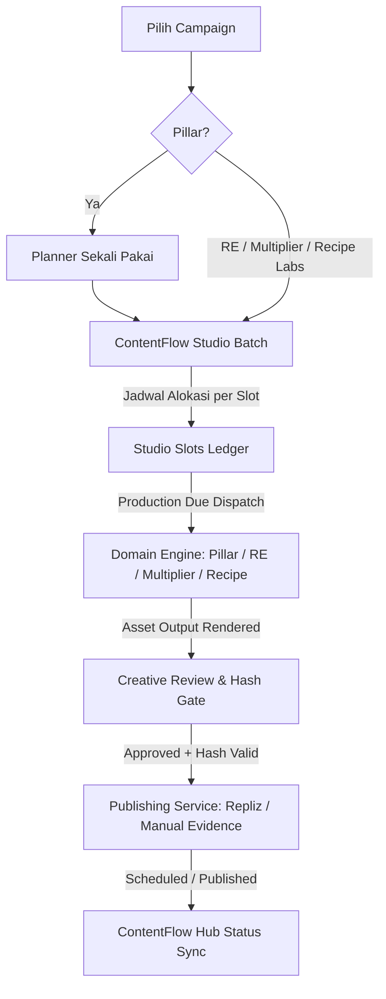

# ContentFlow Studio — Source of Truth (SOT)

## 1. Ikhtisar & Arsitektur

ContentFlow Studio adalah orkestrator kampanye konten visual end-to-end yang menyatukan perencanaan ide (Content Planner), eksekusi mesin produksi multi-engine (Pillar Campaign, RE Campaign, Multiplier Lab, Recipe Labs), dan penerbitan terjadwal lintas platform (Repliz Publishing Engine & ContentFlow Hub).



### 1.1 Invarian Planner Sekali Pakai (Single-Use Planner)
- **Aturan Tegas**: Content Planner yang sudah dimasukkan ke dalam Studio Batch berstatus `consumed`.
- **Server Guard**: Dicek secara atomik di database PostgreSQL melalui tabel `content_planner_consumptions` (`planner_id`, `tenant_id`, `owner_type`, `owner_id`).
- **Pencegahan Mutasi & Bypass**: Setelah dikonsumsi, planner tidak dapat:
  - Dihapus (`DELETE /api/content-planner/[id]`)
  - Diedit barisnya (`PATCH/POST/DELETE /api/content-planner/[id]/rows/[rowId]`)
  - Diregenerate (`regeneratePlannerRow`)
  - Di-research ulang (`requestPlannerResearchRefresh` / `applyPlannerResearchRevision`)
  - Di-ingest ulang via menu lama atau Operator (`ingestPlannerToPillarCampaign`, `ingestRecipePlannerToPillarCampaign`, `operator-content-worker`).
- **Idempotensi**: Permintaan konsumsi ulang oleh batch yang sama bersifat idempotent; permintaan oleh owner atau tenant lain langsung ditolak dengan `409 Conflict`.

### 1.2 Konfigurasi Canonical dan Wizard
- Seluruh form konfigurasi diekstrak menjadi komponen modular di `app/components/campaign-forms/`:
  - `PlannerConfigurationForm.js`: Mendukung mode direct create dan mode capture.
  - `ReCampaignConfigurationForm.js`: Mendukung seluruh opsi audio/tts, visual VSO, model Veo, demografi, dan bridging.
  - `MultiplierConfigurationForm.js`: Mendukung 4 mode workflow (1P×NB, 1B×NP, 1B×NA, 1A×NB), Niche KB dynamic angles, dan preview kombinasi baris.
  - `RecipeLabsConfigurationForm.js`: Mendukung mode Static Recipe Collage (3–6 slot tata letak majalah kuliner) dan Reels Video Storyboard (Naskah & DNA). Storyboard tanpa media final tetap needs_review.
- `PillarConfigurationForm.js` menampung form dan controller asli ImportPlannerModal; modal lama menjadi wrapper kompatibel. Studio merendernya inline dengan `layout='wizard'`.
- Halaman Content Planner, RE, Multiplier dan Recipe menjadi wrapper direct dari komponen canonical. JSX, state, dependency, preset dan serializer handler tidak direkonstruksi dari mockup. Shell/history menu lama tetap dirender dalam mode direct.
- `CampaignConfigurationWizard` hanya mengatur presentasi dan navigasi; tidak mempunyai definisi field tersendiri. Enter sebelum langkah terakhir hanya maju ke langkah berikutnya. State controller tetap hidup saat ke jadwal/review.
- **Dual Mode**:
  - `mode='direct'`: Digunakan oleh menu standalone lama.
  - `mode='capture'`: Digunakan oleh wizard ContentFlow Studio untuk menangkap payload tervalidasi tanpa memicu eksekusi sebelum jadwal tiba.

---

## 2. Antarmuka Pengguna & Fitur Studio

### 2.1 Kalender Bulanan & Tabel Ringkas
- **Navigasi Waktu**: Tombol `Sebelumnya`, `Bulan Ini`, `Selanjutnya` berbasis zona waktu tenant (`Asia/Jakarta`).
- **Tampilan Kalender**: Memetakan setiap slot konten pada tanggal tayang yang ditargetkan (`scheduled_publish_at`).
- **Badge Indikator**:
  - Tipe Engine: `Pillar`, `RE`, `MUL`, `REC`.
  - Status Produksi: `Antrean`, `Diproduksi`, `Perlu Review`, `Gagal`.
  - Status Publikasi: `Disetujui`, `Terjadwal`, `Terbit`.
- **Desain Semantik**: 100% menggunakan design tokens dari `app/theme.css` (`var(--surface)`, `var(--surface-raised)`, `var(--action-primary)`, dll.), sepenuhnya adaptif untuk Light Mode dan Dark Mode.

### 2.2 Wizard Campaign-first
1. Pilih Pillar Campaign, RE, Multiplier, atau Recipe Labs.
2. Hanya Pillar: buat/generate Planner baru, review baris, lalu konfigurasi ImportPlannerModal existing. Focus Recipe memakai jalur culinary Pillar.
3. Mesin lain langsung memakai form konfigurasi existing masing-masing tanpa Planner.
4. Alokasikan jadwal produksi/tayang dan akun per output manifest, simpan Draft, lalu aktifkan Generate Batch.


### 2.3 Gate Review Kreatif & Approval Hash
- **Player & Galeri Media**: Memutar video MP4 hasil render atau menampilkan foto grid resep beresolusi tinggi.
- **Audit Revision Hash**: Menghitung SHA-256 dari `caption + mediaUrl + scheduledPublishAt`. Jika terjadi modifikasi caption atau aset setelah user membuka drawer, approval ditolak hingga user melihat pratinjau yang mutakhir.
- **Salin Teks & Unduh Media**: Tombol 1-klik untuk menyalin caption atau mengunduh media kreatif langsung ke komputer lokal.
- **Pencatatan Bukti Upload Manual**: Mendukung input URL tayang manual (misal jika posting di luar Repliz/Facebook), yang dicatat secara permanen di audit event log.

---

## 3. Worker Background & Penjadwalan Aman

### 3.1 Siklus Eksekusi Worker (`runStudioWorkerTick`)
1. **Atomic Claim**: Menggunakan kueri PostgreSQL `SELECT ... FOR UPDATE SKIP LOCKED` untuk mengambil slot yang memenuhi syarat:
   ```sql
   WHERE s.stage_status = 'pending'
     AND s.scheduled_production_at <= CURRENT_TIMESTAMP
     AND b.status = 'active'
   ```
2. **Perlindungan Future Slot**: Slot dengan `scheduled_production_at` di masa depan secara mutlak **TIDAK AKAN** diproses sebelum waktunya tiba.
3. **Dispatch & Linking**: Memanggil adapter domain (`dispatchSlotProduction`) dan mencatat `source_campaign_id`.
4. **Rekonsiliasi**: Memantau perkembangan render pada `content_flow_items`. Setelah selesai, menandai `stage_status = 'completed'` dan mengisi `final_media_url`.

---

## 4. SOP Rollout, Operasi & Rollback

### 4.1 Migrasi Database (Additive Migration)
Script migrasi eksplisit tersedia di `scripts/migrate-contentflow-studio.mjs`.
- Dry-run:
  ```bash
  node scripts/migrate-contentflow-studio.mjs --schema dev
  ```
- Apply ke dev:
  ```bash
  node scripts/migrate-contentflow-studio.mjs --schema dev --apply --confirm-dev
  ```
- Apply ke staging:
  ```bash
  node scripts/migrate-contentflow-studio.mjs --schema staging --apply --confirm-staging
  ```

> [!WARNING]
> **Production Protection**: Dilarang menjalankan migrasi atau deployment otomatis ke environment Production tanpa instruksi manual eksplisit dari pengguna.

### 4.2 Prosedur Rollback Aman
Jika terjadi kebutuhan rollback aplikasi:
1. Matikan worker studio dengan menonaktifkan trigger scheduler.
2. Symlink `current` pada Mac Mini dapat dikembalikan ke release ID sebelumnya:
   ```bash
   npm run deploy:dev:rollback -- --apply --confirm-dev
   ```
3. Data audit di `content_planner_consumptions`, `content_studio_batches`, `content_studio_slots`, dan `content_studio_events` tetap dipertahankan secara utuh agar tidak ada pekerjaan yang hilang atau publikasi ganda.

## Koreksi Campaign-first — 22 Oktober 2026

Wizard dimulai dari pilihan Pillar, Reverse Engineering, Multiplier, atau Recipe Labs. Planner tidak lagi menjadi prasyarat universal. Pillar memakai Generator Planner baru lalu ImportPlannerModal existing dalam mode capture. Focus Recipe di Planner memakai pipeline culinary Pillar existing. RE, Multiplier dan Recipe Labs mengalokasikan slot berdasarkan output manifest konfigurasi existing tanpa konsumsi Planner.

`engine_kind` pada batch memilih adapter; `source_kind` pada slot menjelaskan asal brief. Batch config versi 2 dibuat atomik bersama slot, target dan consumption bersyarat. Batch baru tetap Draft; Generate Batch mengaktifkan produksi dan worker hanya claim slot aktif yang sudah due. Idempotency key stabil dan hash request menolak reuse key untuk payload berbeda. Identitas domain deterministik per slot dan checkpoint ditulis bersama penciptaan campaign/item.

Status Ready berasal dari aset akhir source item yang tepat. Recipe Labs mode video existing menghasilkan storyboard/report, bukan file video final; hasil ini ditandai Needs Review dan tidak boleh dipublish sebagai video. Untuk produksi video resep final gunakan Recipe Planner pada jalur Pillar.

Approval memakai final_media_url/final_caption/contentflow_id dan revisi yang mengikat akun/jadwal. Target scheduling dengan approval tersimpan dapat dilanjutkan worker melalui publishing service existing; tidak mengulang target yang sudah memiliki job. Perubahan setelah intent aktif memerlukan pembatalan/review lebih dahulu. Status target direkonsiliasi dari publishing_jobs. Publikasi nyata tetap memerlukan approval pengguna dan akun/provider siap.

Migrasi eksplisit: `scripts/migrate-contentflow-studio-campaign-first.mjs --schema dev|staging` (dry-run), lalu `--apply --confirm-dev|--confirm-staging`. Script menolak Production. Slot legacy dengan engine belum terbukti ditandai legacy_requires_review dan batch aktif dipause; consumption tidak dibuka. Audit scoped: `scripts/audit-repair-contentflow-studio.mjs --schema <env> --tenant <id>`. Audit tidak melakukan regenerate/publish.

Boot worker Studio memerlukan `ENABLE_CONTENTFLOW_STUDIO=true` serta background services aktif. Nonaktifkan flag sebelum rollback ke versi lama yang belum memahami mapping baru. Review manual UI dilakukan melalui link Dev/Staging; test otomatis tidak berarti approval manual pengguna.

## Wizard konfigurasi dan kontrak batch versi 3

Alur: pilih campaign → konfigurasi canonical per bagian → jadwal semua output → review batch → simpan draft → Generate Content. Pillar mempunyai Generate Planner dan Review Planner sebelum konfigurasi produksi. Planner baru ini consumed atomik hanya ketika batch berhasil disimpan; tidak ada Bank Ide.

RE mempertahankan Single/Mass Production, CSV/XLSX, mode eksekusi, angle multiplier, visual/VSO, bridging, audio dan seluruh preset. Multiplier mempertahankan empat workflow dan batas 20 kombinasi sesuai API asal. Recipe mempertahankan Static Post/kolase dan Reels Video Storyboard. Batas jumlah pada UI/API masing-masing engine tetap mengikuti sumbernya; Recipe Planner bukan Recipe Labs.

Batch baru memakai `schemaVersion=3` dengan normalisasi/validasi server, ownership referensi katalog dan aset, serta rekonstruksi manifest. Bentuk batch lama tetap dibaca. Perlindungan aset dan tenant juga berlaku pada input versi lama. Flag FormData `'0'`/`'1'` diproses sebagai boolean/numerik yang benar.

### Slot RE multi-angle

Satu URL sumber membuat satu invocation campaign/item; varian 3/4/5 disimpan oleh engine asli di re_item_angle_variants. Slot varian berbagi invocation key dan waktu mulai produksi, tetapi memiliki jadwal tayang/approval sendiri. Lock dan deterministic executionOwner mencegah parent ganda. Setelah tersedia, ordinal varian dipin ke variant ID pada snapshot slot. Ketidaksesuaian jumlah varian menjadi needs_review.

Variant siap hanya jika FFmpeg dan upload selesai serta caption ada. Slot menyimpan media/caption final tanpa menganggap parent RE sebagai video final. Caption awal memakai caption parent bila ada, atau deskripsi/nama angle sebagai fallback untuk review. Pengguna tetap memverifikasi caption sebelum approval.

Key output batch versi 3 mengikuti identitas sumber/kombinasi, bukan posisi tampilan. Perubahan urutan tidak memindahkan jadwal ke sumber lain. Recipe count yang bertambah mempertahankan key hasil yang sudah direncanakan. Perubahan brief Recipe membentuk key baru.

### Aset dan publishing

`POST /api/v2/contentflow-studio/assets` menyimpan gambar tervalidasi (maksimal 10 MB) pada prefix tenant di shared public/uploads/studio. Upload Multiplier menggunakan endpoint ini; referensi gambar pustaka produk tetap didukung jika milik tenant. File tidak disimpan dalam JSON. RE multipart batch memakai staging yang sama. Referensi path arbitrer, lintas tenant, traversal atau file yang sudah tidak ada ditolak. Path upload RE lama diterima hanya jika content hash yang terikat tenant terbukti benar.

Konfigurasi user disimpan utuh. Saat dispatch, policy Studio menonaktifkan direct social post/draft termasuk nested config_json, audio_config_json dan shared_config. Ini mencegah bypass approval dan publikasi ganda. Approval Studio tetap satu-satunya pintu publishing.

Kelima form menggunakan semantic theme tokens pada style yang direlokasi; parameter warna background kolase merupakan pengaturan konten, bukan palet tema UI.
