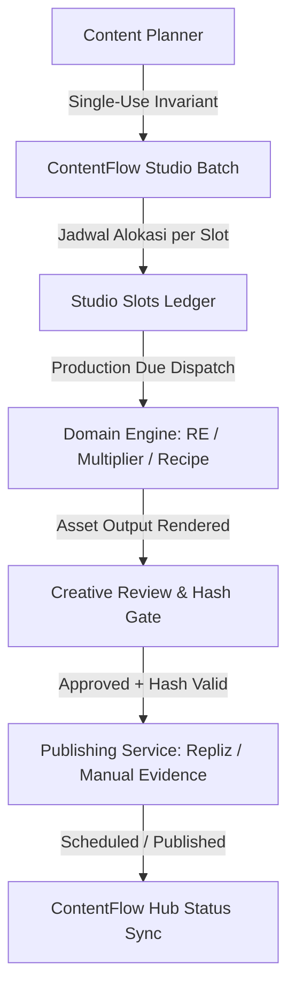

# ContentFlow Studio — Source of Truth (SOT)

## 1. Ikhtisar & Arsitektur

ContentFlow Studio adalah orkestrator kampanye konten visual end-to-end yang menyatukan perencanaan ide (Content Planner), eksekusi mesin produksi multi-engine (RE Campaign, Multiplier Lab, Recipe Labs), dan penerbitan terjadwal lintas platform (Repliz Publishing Engine & ContentFlow Hub).



### 1.1 Invarian Planner Sekali Pakai (Single-Use Planner)
- **Aturan Tegas**: Content Planner yang sudah dimasukkan ke dalam Studio Batch berstatus `consumed`.
- **Server Guard**: Dicek secara atomik di database PostgreSQL melalui tabel `content_planner_consumptions` (`planner_id`, `tenant_id`, `owner_type`, `owner_id`).
- **Pencegahan Mutasi & Bypass**: Setelah dikonsumsi, planner tidak dapat:
  - Dihapus (`DELETE /api/content-planner/[id]`)
  - Diedit barisnya (`PATCH/POST/DELETE /api/content-planner/[id]/rows/[rowId]`)
  - Diregenerate (`regeneratePlannerRow`)
  - Di-research ulang (`requestPlannerResearchRefresh` / `applyPlannerResearchRevision`)
  - Di-ingest ulang via menu lama atau Operator (`ingestPlannerToPillarCampaign`, `ingestRecipePlannerToPillarCampaign`, `operator-content-worker`).
- **Idempotensi**: Permintaan konsumsi ulang oleh batch yang sama bersifat idempotent; permintaan oleh owner atau tenant lain langsung ditolak dengan `409 Conflict`.

### 1.2 Form Sharing Kontrak (Zero Behavior Drift)
- Seluruh form konfigurasi diekstrak menjadi komponen modular di `app/components/campaign-forms/`:
  - `PlannerConfigurationForm.js`: Mendukung mode direct create dan mode capture.
  - `ReCampaignConfigurationForm.js`: Mendukung seluruh opsi audio/tts, visual VSO, model Veo, demografi, dan bridging.
  - `MultiplierConfigurationForm.js`: Mendukung 4 mode workflow (1P×NB, 1B×NP, 1B×NA, 1A×NB), Niche KB dynamic angles, dan preview kombinasi baris.
  - `RecipeLabsConfigurationForm.js`: Mendukung mode Static Recipe Collage (3–6 slot tata letak majalah kuliner) dan Video Reels Recipe sekuensial.
- **Dual Mode**:
  - `mode='direct'`: Digunakan oleh menu standalone lama.
  - `mode='capture'`: Digunakan oleh wizard ContentFlow Studio untuk menangkap payload tervalidasi tanpa memicu eksekusi sebelum jadwal tiba.

---

## 2. Antarmuka Pengguna & Fitur Studio

### 2.1 Kalender Bulanan & Tabel Ringkas
- **Navigasi Waktu**: Tombol `Sebelumnya`, `Bulan Ini`, `Selanjutnya` berbasis zona waktu tenant (`Asia/Jakarta`).
- **Tampilan Kalender**: Memetakan setiap slot konten pada tanggal tayang yang ditargetkan (`scheduled_publish_at`).
- **Badge Indikator**:
  - Tipe Engine: `RE`, `MUL`, `REC`.
  - Status Produksi: `Antrean`, `Diproduksi`, `Perlu Review`, `Gagal`.
  - Status Publikasi: `Disetujui`, `Terjadwal`, `Terbit`.
- **Desain Semantik**: 100% menggunakan design tokens dari `app/theme.css` (`var(--surface)`, `var(--surface-raised)`, `var(--action-primary)`, dll.), sepenuhnya adaptif untuk Light Mode dan Dark Mode.

### 2.2 Wizard Kreasi 4-Tahap
1. **Tahap 1 — Ide & Riset Planner**: Membuat planner ide konten baru secara otomatis.
2. **Tahap 2 — Pilih Engine**: Memilih target engine (RE Campaign, Multiplier Lab, atau Recipe Labs).
3. **Tahap 3 — Konfigurasi Form Engine**: Mengisi parameter spesifik mesin (gaya visual, voice persona, VSO karakter, rasio aspek, tata letak grid, dll.).
4. **Tahap 4 — Alokasi Jadwal**: Mengatur tanggal dan jam tayang per baris slot; sistem secara otomatis menghitung waktu mulai produksi yang lebih awal.

### 2.3 Gate Review Kreatif & Approval Hash
- **Player & Galeri Media**: Memutar video MP4 hasil render atau menampilkan foto grid resep beresolusi tinggi.
- **Audit Revision Hash**: Menghitung SHA-256 dari `caption + mediaUrl + scheduledPublishAt`. Jika terjadi modifikasi caption atau aset setelah user membuka drawer, approval ditolak hingga user melihat pratinjau yang mutakhir.
- **Salin Teks & Unduh Media**: Tombol 1-klik untuk menyalin caption atau mengunduh media kreatif langsung ke komputer lokal.
- **Pencatatan Bukti Upload Manual**: Mendukung input URL tayang manual (misal jika posting di luar Repliz/Facebook), yang dicatat secara permanen di audit event log.

---

## 3. Worker Background & Penjadwalan Aman

### 3.1 Siklus Eksekusi Worker (`runStudioWorkerTick`)
1. **Atomic Claim**: Menggunakan kueri PostgreSQL `SELECT ... FOR UPDATE SKIP LOCKED` untuk mengambil slot yang memenuhi syarat:
   ```sql
   WHERE s.stage_status = 'pending'
     AND s.scheduled_production_at <= CURRENT_TIMESTAMP
     AND b.status = 'active'
   ```
2. **Perlindungan Future Slot**: Slot dengan `scheduled_production_at` di masa depan secara mutlak **TIDAK AKAN** diproses sebelum waktunya tiba.
3. **Dispatch & Linking**: Memanggil adapter domain (`dispatchSlotProduction`) dan mencatat `source_campaign_id`.
4. **Rekonsiliasi**: Memantau perkembangan render pada `content_flow_items`. Setelah selesai, menandai `stage_status = 'completed'` dan mengisi `final_media_url`.

---

## 4. SOP Rollout, Operasi & Rollback

### 4.1 Migrasi Database (Additive Migration)
Script migrasi eksplisit tersedia di `scripts/migrate-contentflow-studio.mjs`.
- Dry-run:
  ```bash
  node scripts/migrate-contentflow-studio.mjs --schema dev
  ```
- Apply ke dev:
  ```bash
  node scripts/migrate-contentflow-studio.mjs --schema dev --apply --confirm-dev
  ```
- Apply ke staging:
  ```bash
  node scripts/migrate-contentflow-studio.mjs --schema staging --apply --confirm-staging
  ```

> [!WARNING]
> **Production Protection**: Dilarang menjalankan migrasi atau deployment otomatis ke environment Production tanpa instruksi manual eksplisit dari pengguna.

### 4.2 Prosedur Rollback Aman
Jika terjadi kebutuhan rollback aplikasi:
1. Matikan worker studio dengan menonaktifkan trigger scheduler.
2. Symlink `current` pada Mac Mini dapat dikembalikan ke release ID sebelumnya:
   ```bash
   npm run deploy:dev:rollback -- --apply --confirm-dev
   ```
3. Data audit di `content_planner_consumptions`, `content_studio_batches`, `content_studio_slots`, dan `content_studio_events` tetap dipertahankan secara utuh agar tidak ada pekerjaan yang hilang atau publikasi ganda.
